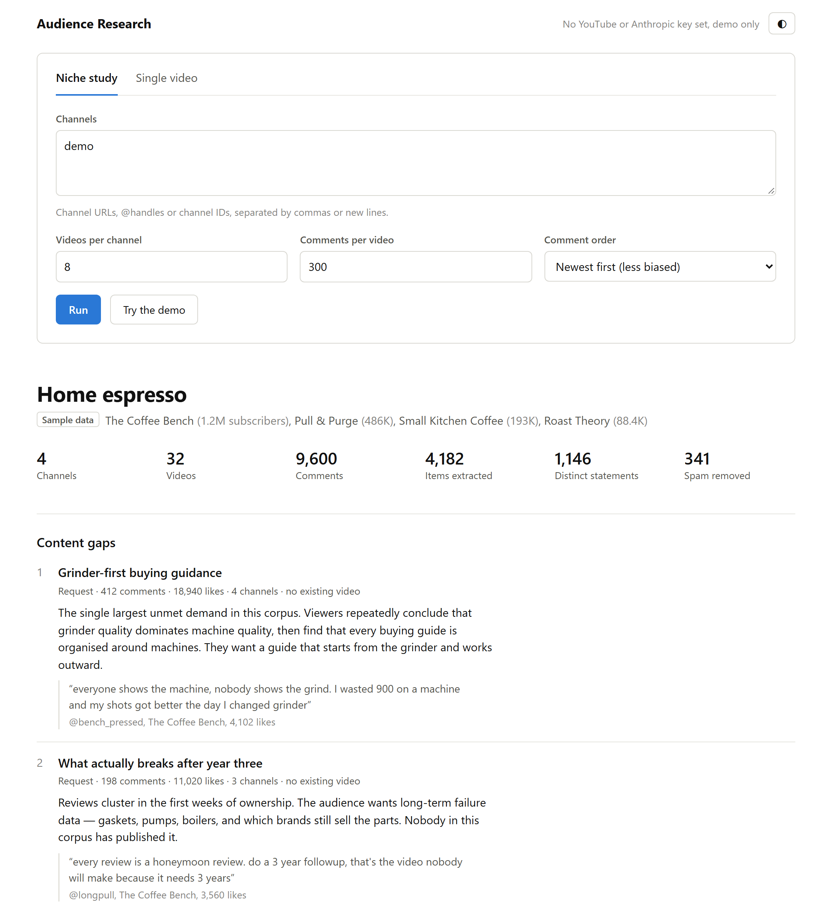
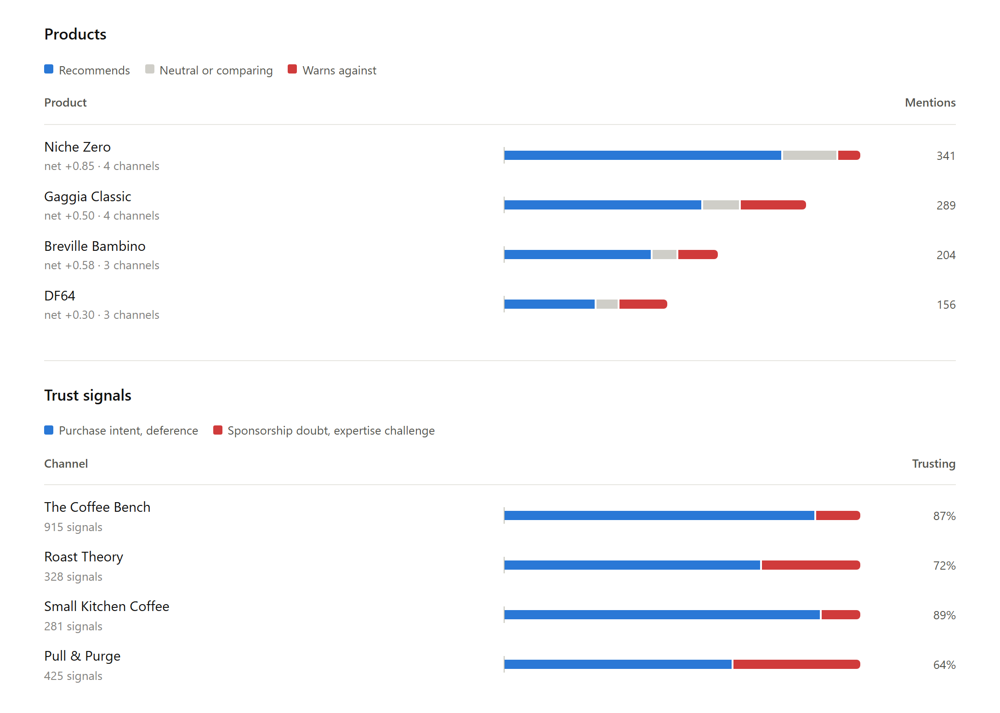

# YouTube Audience Research

Give it a few YouTube channels in the same niche and it reads a sample of their
comments to work out what the audience keeps asking for that nobody has made a
video about yet. It also shows which channels share an audience, which products
people talk about and how, and which topics are picking up.

This started as a sentiment analysis project: first a Naive Bayes classifier
trained on Sentiment140, then VADER. Positive/negative scores turned out to say
very little about YouTube comments. Nearly every video scores positive, sarcasm
flips the score, and most comments are timestamps and in-jokes that end up as
"neutral". So the project now pulls out what people actually ask for, complain
about and get wrong, and counts that instead.



## Running it

You need Python 3.11 or newer.

```bash
git clone https://github.com/Equinox2005/youtube-sentiment-analysis.git
cd youtube-sentiment-analysis
python -m venv .venv
source .venv/bin/activate        # Windows: .venv\Scripts\activate
pip install -r requirements.txt
uvicorn app.main:app
```

Open http://127.0.0.1:8000 and click **Try the demo**, or go straight to
http://127.0.0.1:8000/?demo. The demo is a bundled sample study, so it runs
without any API keys.

For real runs, copy `.env.example` to `.env` and fill in two keys:

- `YOUTUBE_API_KEY`: a YouTube Data API v3 key from the
  [Google Cloud Console](https://console.cloud.google.com/). The free tier gives
  10,000 quota units a day.
- `ANTHROPIC_API_KEY`: from the [Anthropic Console](https://console.anthropic.com/).
  Claude does the reading and the clustering.

The same thing works from the command line:

```bash
python cli.py study @channel1 @channel2 @channel3 --videos 8 --comments 300
python cli.py video "https://www.youtube.com/watch?v=VIDEO_ID"
python cli.py estimate --channels 12 --videos 8 --comments 500
python cli.py study demo
```

Reports are also available as JSON and CSV from the HTTP API; the endpoints are
listed at http://127.0.0.1:8000/docs.

## How it works

1. **Fetch.** Each channel's uploads playlist gives its latest videos, and
   comments are pulled newest first, which is less skewed toward viral comments
   than "top". It never calls `search.list`, which costs 100 quota units per
   call. `python cli.py estimate --channels 12 --videos 8 --comments 500` comes
   to 506 units, so about 19 studies like that a day on the free tier.
2. **Map.** Comments go to Claude in batches of 50. For each comment it returns
   zero or more items (a request, question, complaint, confusion, correction,
   praise or product mention) with a short normalised summary, plus spam flags
   and trust signals. Structured outputs keep the JSON valid.
3. **Fold.** Identical summaries are merged and counted locally, so thousands
   of items become a few hundred distinct statements before the next model call.
4. **Reduce.** One Claude call per item type groups those statements into named
   themes.
5. **Analyse.** The rest is plain Python. Request, question and confusion themes
   are compared against the titles, tags and descriptions already published to
   find gaps; commenter IDs give the audience overlap between channels; dates
   give the themes that are rising.

When the default model declines a batch, the API retries it on another model. A
batch that still fails is skipped and counted rather than sinking the whole
study. Every report lists its YouTube quota use and an estimate of the model
cost.



## Limits

- Commenters are a small, opinionated slice of the audience. The counts measure
  how often something is said, not how many viewers think it.
- Comments are capped per video, so videos with huge comment sections are
  under-sampled.
- Themes are a language model's grouping. The counts are exact, but the groups
  are worth checking against the quoted comments.
- Gap detection is keyword overlap with existing videos. A video that covers a
  topic without naming it in its title, tags or description won't count.
- Real runs cost money. Both passes default to `claude-opus-5-5`.
  `NICHE_MAP_MODEL=claude-haiku-5-5` makes the expensive pass much cheaper, and
  `NICHE_USE_BATCH_API=true` halves the price but can take hours (see
  `.env.example`).
- Reports are kept in memory and disappear when the server stops.

## Layout

```
app/
  youtube.py     YouTube Data API calls and quota accounting
  extraction.py  map and reduce passes against the Claude API
  niche.py       folding, themes, content gaps, overlap, products, trends
  analysis.py    single-video reports and the timestamp heatmap
  main.py        FastAPI routes, streamed progress, CSV and JSON export
  demo.py        the bundled sample reports
static/          the frontend: plain JavaScript and SVG, no build step
cli.py           command line interface
tests/           pytest suite
```

## Tests

```bash
pip install -r requirements-dev.txt
pytest
```

The tests stub out both APIs, so they run offline and without keys.
